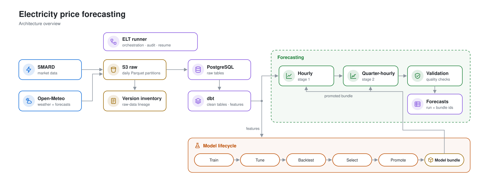

# Time-Series Forecasting for Energy Markets

Energy markets are fundamentally time-dependent: demand, renewable generation, weather, and price formation all evolve hour by hour (or quarter-hour by quarter-hour). In day-ahead power markets, decisions are made *before* realized prices are known, so forecast quality directly affects dispatch quality, trading outcomes, and risk exposure.

This is especially important for batteries and flexible portfolios, where each wrong forecast can consume limited cycle budget on suboptimal spreads.

## Motivation from external benchmark evidence

This work is motivated by the Re-Twin Energy article:

- **Article:** *Impact of Day-Ahead Forecast Accuracy on BESS Revenues*
- **URL:** https://re-twin.energy/blog/impact-of-day-ahead-forecast
- **Study setup (article):** Germany, 15-minute day-ahead prices, Jan–Mar 2026 backtest

### Financial impact figures reported in the article

For a representative **2h battery, 1.5 cycles/day**, the article reports:

| Signal | Revenue (EUR/MW) | Captured vs Perfect Foresight | Gap to Perfect Foresight (EUR/MW) |
|---|---:|---:|---:|
| Previous-day baseline | 10,904 | 78.4% | 3,010 |
| Re-Twin forecast | 11,628 | 83.6% | 2,286 |
| Electricity Maps forecast | 12,163 | 87.4% | 1,751 |
| Perfect foresight | 13,914 | 100.0% | 0 |

The same article reports price-forecast MAE values:

- Previous-day baseline: **27.9 EUR/MWh**
- Re-Twin forecast: **21.4 EUR/MWh**
- Electricity Maps forecast: **17.2 EUR/MWh**

These numbers provide a practical business reason for this project: reducing forecasting error can materially increase realized value from the same physical energy asset.

## Current implementation

The repository implements the data, ELT, and forecasting workflow locally, with AWS used for the raw data lake and development database foundation.

### Data sources and ingestion

- **SMARD:** configurable historical backfills and incremental daily ingestion collect German electricity-market data, including generation, consumption, and day-ahead prices at hourly and quarter-hourly resolution.
- **Open-Meteo:** historical weather observations and leak-safe weather forecasts supply wind, solar, cloud, and temperature signals for model features.
- **Partitioned raw storage:** each source is written to S3 as Parquet partitions by calendar day; existing partitions can be skipped for incremental processing or deliberately overwritten when source data is revised.
- **Raw-data lineage:** every upload updates an immutable inventory of S3 object versions so downstream runs can be traced back to their exact inputs.

### ELT and data quality

- **Orchestration:** the ELT runner coordinates ingestion, raw-inventory recording, PostgreSQL loading, and dbt transformations for a requested date range.
- **PostgreSQL and dbt:** raw source records are loaded into PostgreSQL, then dbt produces cleaned analytical tables and model-ready feature data.
- **Auditing and recovery:** pipeline and stage status, configuration hashes, row counts, and error details are recorded. Failed work can resume from its recorded execution state rather than repeating completed stages.

### Forecasting and model lifecycle

- **Two-stage price forecasting:** separate hourly and quarter-hourly models generate next-day electricity-price forecasts. Predictions are checked for missing values, duplicates, invalid timestamps, and quantile crossings before they are persisted.
- **Traceable outputs:** persisted forecasts retain links to the source ELT run and model bundle used to generate them.
- **Experimentation:** the codebase includes training, hyperparameter tuning, rolling and expanding-window evaluation, reporting, candidate selection, and production-model promotion utilities.

### AWS foundation

Terraform has already provisioned a development S3 data/artifact bucket and private PostgreSQL RDS environment in `eu-north-1`. It is a foundation only: workloads are not yet scheduled or deployed as cloud compute services.

## Project lineage

The original end-to-end data [platform](https://github.com/hasanerdin/zephyrwerk-platform/tree/main) and ML workflow was developed by **Hasan Erdin**. I adapted and extended this repository for focused **time-series forecasting and experimentation**, including rolling/expanding-window evaluation and comparative benchmarking.

## Metrics achieved in this repository

The table below summarizes the key forecasting results from the reports in `ml/artifacts` and compares each MAE against the article benchmark MAE.

> Data sources in this repo: `ml/artifacts/price_hourly_model_report.json`, `ml/artifacts/price_forecast_model_report.json`, `ml/artifacts/re_twin_study_price_benchmark_report.json`.

| Model / Evaluation | MAE (EUR/MWh) | Baseline MAE (EUR/MWh) | Training Window | Test / Holdout Window | MAE vs Article Electricity Maps (17.2) |
|---|---:|---:|---|---|---:|
| Article benchmark: Electricity Maps forecast | 17.2 | 27.9 (prev-day) | n/a (external study) | 2026-01-01 to 2026-03-31 | 0.000 |
| Article benchmark: Re-Twin forecast | 21.4 | 27.9 (prev-day) | n/a (external study) | 2026-01-01 to 2026-03-31 | +4.200 |
| Price hourly (2-stage weekly expanding, Stage 1 holdout aggregate) | 15.276 | 26.948 | Expanding from 2023-05-01 up to each forecast week start | 2026-01-01 to 2026-04-01 (exclusive) | -1.924 |
| Price quarter-hourly (2-stage weekly expanding, Stage 2 holdout aggregate) | **17.715** | 26.095 | Expanding from 2025-10-01 up to each forecast week start | 2026-01-01 to 2026-04-01 (exclusive) | **+0.515** (achieved best) |

<!-- | Price hourly (single-window holdout) | **16.178** | 26.863 | 2023-05-01 00:00 to 2025-12-31 23:00 | 2026-01-01 00:00 to 2026-03-31 23:00 | **-1.022** (better) | **-5.222** (better) |
 -->

### Interpretation

- The repository’s **hourly models** (both single-window and Stage 1 in 2-stage backtest) outperform the article’s published 17.2 EUR/MWh reference MAE.
- The **quarter-hour Stage 2 model** is slightly above 17.2 EUR/MWh, but still materially better than the article’s 21.4 EUR/MWh Re-Twin MAE and much better than previous-day baseline levels.

### Notes on comparability

- External and internal studies are not perfectly identical (data contract details, data omission, model classes, and holdout slicing most possibly differ).
- The article benchmark report stored in this repo explicitly preserves published MAE values and notes that additional metrics (RMSE, R², directional accuracy) were not provided in the source article.
- **Use MAE comparisons as directional performance context rather than strict like-for-like head-to-head claims.**

## TODO: Move the workflow to AWS with Terraform

The next step is to make the existing workflow portable and scheduled without changing its data contracts or lineage.

1. Move Terraform state to a dedicated private remote backend with locking.
2. Use Terraform to add least-privilege IAM, ECR repositories, ECS Fargate tasks, CloudWatch logging, and private database access for the existing ELT and forecast containers.
3. Schedule the workflow with EventBridge and Step Functions, then add CI/CD to validate Terraform and deploy approved container images.
